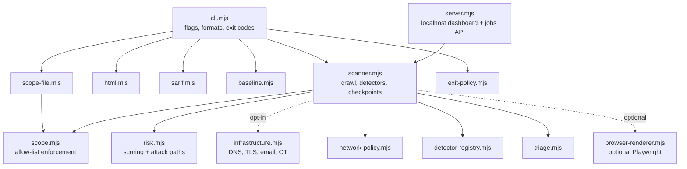

# Architecture

SentinelScan is a dependency-free Node.js (ES modules) application. This page explains how the pieces fit so you can read, extend, or audit them.

- [Module map](#module-map)
- [Scan lifecycle](#scan-lifecycle)
- [Design decisions](#design-decisions)
- [The report](#the-report)
- [Checkpoints](#checkpoints)
- [Extension points](#extension-points)

## Module map



| Module | Responsibility | Lines |
| --- | --- | ---: |
| `scanner.mjs` | Bounded crawl, all detectors, well-known path checks, checkpoints, report assembly | ~1,479 |
| `detector-registry.mjs` | Static detector catalog and metadata validation | ~100 |
| `network-policy.mjs` | DNS checks, private-network blocking, address-pinned GET/HEAD transport | ~260 |
| `triage.mjs` | Exact fingerprint suppressions and actionable finding selection | ~50 |
| `exit-policy.mjs` | CI severity and baseline policy evaluation | ~50 |
| `browser-renderer.mjs` | Optional ephemeral Playwright mode with request interception | ~150 |
| `cli.mjs` | Argument parsing, output formats, baseline comparison | ~188 |
| `server.mjs` | Localhost dashboard, asynchronous scan jobs, request validation | ~266 |
| `infrastructure.mjs` | Opt-in DNS, TLS, SPF/DMARC/DKIM/CAA, Certificate Transparency | ~241 |
| `risk.mjs` | Severity weights, diminishing returns, confidence, attack-path rules | ~104 |
| `scope.mjs` | Origin and path allow-listing (exact and leading-subdomain wildcard) | ~105 |
| `baseline.mjs` | Fingerprint-based report comparison and identity validation | ~103 |
| `html.mjs` | Standalone HTML report (all evidence is escaped) | ~50 |
| `sarif.mjs` | SARIF 2.1.0 export | ~43 |
| `scope-file.mjs` | Loads and validates a scope file | ~10 |

## Scan lifecycle

```mermaid
sequenceDiagram
    participant C as CLI or Server
    participant S as scan()
    participant G as Scope gate
    participant T as Target
    participant R as Risk engine

    C->>S: target + options
    S->>G: assert target is in scope
    S->>S: normalize options, budgets, auth-header origins
    loop while queue, budget and time remain
        S->>G: assert URL is in scope
        S->>T: policy-gated GET (redirects handled manually, each hop re-checked)
        T-->>S: response
        S->>S: run detectors, extract links + resources, update inventory
        S->>S: write checkpoint (if enabled)
    end
    S->>T: GET nine fixed well-known paths (paced, counted in budget)
    S->>S: optional infrastructure checks (paced, counted, cancelable)
    S->>R: findings
    S->>S: apply triage; retain suppressed findings
    R-->>S: attack paths + risk score from actionable findings
    S-->>C: report (schema v2)
```

The crawl is **breadth-first and sequential**. There is no concurrency, which keeps ordering deterministic, makes budgets exact, and keeps load on the target predictable.

## Design decisions

**Scope is checked at three layers.** At enqueue time (so out-of-scope links never enter the queue), immediately before each request, and again on every redirect hop. A bug in one layer does not open the gate.

**Authorization is enforced at the engine boundary.** The CLI and dashboard pass `confirmAuthorized: true`, but importing `scan()` directly requires the same explicit acknowledgement. A scope alone is not treated as proof of authorization.

**Findings are plain data.** Detectors call `finding(id, severity, title, evidence, location, remediation)`, which validates the ID and severity against the static detector registry, then adds a stable fingerprint and confidence profile. Nothing about a finding is computed lazily, so reports are trivially serializable, diffable, and cacheable.

**Fingerprints are stable across runs.** A fingerprint is the first 16 hex characters of `sha256("<id>|<origin><path>")`. Query strings are deliberately excluded so a finding keeps its identity when a session parameter changes. This is what makes baseline comparison and cross-run matching work. Because several distinct instances can share a fingerprint (two cookies missing `HttpOnly`, say), baseline comparison matches them as a multiset: by identical evidence first, then by count. Nothing is silently merged.

**Confidence is separate from severity.** Severity says how bad it would be *if real*; confidence says how sure the scanner is. Candidate findings (for example a value that merely *looks* like a secret) carry lower confidence and are discounted in the score.

**Triage is separate from confidence.** Active suppressions require an exact fingerprint, a reason, and an expiration. Suppressed findings remain in `findings`, but `summary.actionableFindings`, risk, attack paths, SARIF defaults, and CI severity gates exclude them. Expired suppressions are visible and open again.

**Risk uses diminishing returns.** The first occurrence of a finding counts fully, and each repeat counts less (`1/(n+1)`). Crawl depth cannot overwhelm prioritization.

**Attack paths are data.** Correlation rules are a declarative array in `risk.mjs`. Adding a rule needs no new code path.

**Every request is paced.** A single pacer enforces the minimum gap between requests, and every outbound call, including redirect hops, well-known checks, and opt-in infrastructure operations, goes through the one function that consults it. There is no request path that can skip the delay, and the wait is cancelable.

**A timeout is a finding; a cancellation is a stop.** A request that times out is recorded as a `request-failed` finding and the scan continues. Only an operator cancellation (the abort signal) ends the scan.

**Zero dependencies by default.** Passive networking uses a built-in address-pinned transport, DNS/TLS use Node's standard library, and tests use `node:test`. Rendered mode loads optional Playwright only when explicitly selected.

## The report

Reports use `schemaVersion: 2`. Top-level keys:

| Key | Contents |
| --- | --- |
| `schemaVersion` | Currently `2` |
| `scanner` | `name`, `version`, `mode` |
| `target`, `scope` | What was scanned and the scope that governed it |
| `startedAt`, `finishedAt` | ISO timestamps |
| `limits` | The effective budgets and auth-header **origins**. Header **values** are never included |
| `summary` | Counts, elapsed time, `termination` reason, severity and confidence breakdowns, risk score and grade |
| `pages`, `resources` | What was visited |
| `requests` | Per-request timeline: URL (redacted), status, elapsed ms, bytes read, redirect target |
| `infrastructure` | DNS/TLS/email/CT metadata (only when enabled) |
| `inventory` | Forms, password forms, scripts, links, client API endpoints, source maps |
| `findings` | Every finding, with fingerprint, evidence, and remediation |
| `suppressions` | The normalized exact-fingerprint suppression input |
| `attackPaths` | Correlated stories linking finding fingerprints |
| `risk` | `score`, `grade`, `method`, `factors`, per-finding `contributions`, `priority` order |
| `notes` | Execution budget used, whether the queue was exhausted, and reminders |
| `comparison` | Added by the CLI when `--baseline` is used |
| `exitPolicy` | The selected CI policy, matched findings, reasons, and failed state |

`summary.termination` is `queue-exhausted` on a normal finish, or a human-readable reason such as "Maximum page budget reached." when a budget stopped the run early.

## Checkpoints

A checkpoint is a JSON file (`schemaVersion: 2`) holding the queue, deferred budget work, visited set, findings, inventory, and request log. It is written after each unit of work by writing a temporary file and renaming it, so an interruption can never leave a half-written checkpoint. Budget-stopped runs remain `in-progress` and can resume after the relevant limit is increased; normally exhausted runs are `complete`.

On resume, SentinelScan refuses to continue if the target or the scope differs from the checkpoint. When a checkpoint of a *completed* scan is passed to the CLI, it returns the stored report without contacting the target again.

## Extension points

| I want to... | Touch |
| --- | --- |
| Add a detector | `src/scanner.mjs`, plus a test. See [CONTRIBUTING.md](../CONTRIBUTING.md#adding-a-detector) |
| Add a correlation rule | `DEFAULT_ATTACK_PATH_RULES` in `src/risk.mjs`. See [CONTRIBUTING.md](../CONTRIBUTING.md#adding-an-attack-path-rule) |
| Change a finding's confidence | The descriptor in `src/detector-registry.mjs` |
| Add an output format | A small pure function `report => string`, wired into `src/cli.mjs` |
| Call it from your own code | `import { scan } from "sentinelscan"` (returns the report object) |

```js
import { scan } from "./src/scanner.mjs";

const report = await scan("https://your-authorized-site.example", {
  confirmAuthorized: true,
  scope: { name: "prod", allowedOrigins: ["https://your-authorized-site.example"] },
  maxPages: 10,
  delayMs: 500,
});
console.log(report.risk.grade, report.summary.findings);
```
