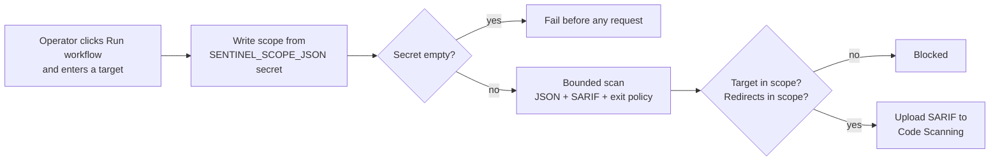

# GitHub Actions

SentinelScan is designed to run safely on GitHub **without placing a target URL, scope, or credentials in source control**.

- [What runs automatically](#what-runs-automatically)
- [The optional authorized scan](#the-optional-authorized-scan)
- [Setup](#setup)
- [How it stays safe](#how-it-stays-safe)
- [Reading the results](#reading-the-results)
- [Troubleshooting](#troubleshooting)

## What runs automatically

These workflows never contact a website.

| Workflow | Trigger | What it does |
| --- | --- | --- |
| **Quality** | Push to `main`/`master`, pull requests | Runs `npm test` and syntax checks on **Node.js 20 and 22** |
| **CodeQL** | Push to `main`/`master`, pull requests, weekly (Mondays 03:23 UTC) | Read-only JavaScript security analysis |
| **Dependabot** | Monthly | Proposes updates to GitHub Action versions |

## The optional authorized scan

The **Authorized SentinelScan** workflow is manual **by design**. It runs only when an operator chooses **Run workflow** and supplies a target.



Key properties of the workflow:

- Runs only on `workflow_dispatch` with a required `target` input
- Skips runs selected on a non-default branch and checks out the exact default-branch commit that triggered the run
- Uses the `authorized-scan` environment; its deployment branch rule must allow only the default branch so other refs cannot receive the scope secret
- 10-minute job timeout
- Permissions limited to `contents: read` and `security-events: write`
- Uses `--confirm-authorized`: **choosing Run workflow is your confirmation**, so restrict who can do it
- Produces JSON and SARIF from one scan without printing the private report to the job log, then uploads SARIF to GitHub Code Scanning under the category `sentinelscan`
- Exposes manual `fail_on_severity` and `fail_on_baseline` inputs; policy failures use exit code `2`, and SARIF/artifacts still upload with `if: always()`
- Passes the scope secret only to the step that writes the private scope file; that file is removed before uploads

## Setup

1. Open the repository's **Settings**, then **Environments**, and create an environment named **`authorized-scan`**.
2. In that environment, set **Deployment branches and tags** to **Selected branches and tags**, and allow only the repository's default branch.
3. Delete any repository-level `SENTINEL_SCOPE_JSON` secret, then add **`SENTINEL_SCOPE_JSON`** as an environment secret. A repository-level copy would remain available to workflows on other refs.
4. Set its value to a scope, for example:

```json
{
  "name": "authorized-production-scope",
  "allowedOrigins": [
    "https://your-authorized-site.example",
    "https://*.assets.your-authorized-site.example"
  ],
  "excludePaths": ["/logout"]
}
```

5. Go to **Actions**, choose **Authorized SentinelScan**, select the repository's default branch, click **Run workflow**, and enter a target that is inside that scope. Runs selected on other refs are skipped.

The scope format is the same as the CLI's. See the [scope file reference](CLI.md#scope-file).

## How it stays safe

| Protection | Detail |
| --- | --- |
| **No scope in source control** | The scope lives in an encrypted environment secret protected by a default-branch deployment rule, is written with mode `0600` in a dedicated step, and is removed before any upload step |
| **Empty scope refused** | The workflow fails if the secret is empty |
| **Scope enforced by the scanner** | A target outside the allowed exact or wildcard origins is blocked, and so are redirects outside the scope or configured paths |
| **Bounded** | Default budgets apply: 20 pages, 40 resources, 80 requests, 120 seconds |
| **Private-network gate** | Non-public DNS and literal addresses are blocked unless an explicit local-only option is used; the workflow does not enable it |
| **Opt-in extras** | Infrastructure and Certificate Transparency checks are **off** in CI. Enable them only if they are inside the written assessment scope |
| **Least privilege** | The token can read contents and write security events, nothing else |

> [!IMPORTANT]
> Restrict who can edit the environment secret and its deployment-branch rule, protect the default branch, and keep a written authorization record for every target you scan.

## Reading the results

SARIF findings appear in the repository's **Security** tab under **Code scanning**.

| SentinelScan severity | SARIF level |
| --- | --- |
| high | `error` |
| medium | `warning` |
| low, info | `note` |

Each result carries the finding's stable fingerprint in SARIF `partialFingerprints.sentinelscan`, plus an evidence fingerprint for duplicate instances, so the same issue can be matched across runs.

The JSON artifact also contains `exitPolicy`, actionable/suppressed counts, and any baseline comparison. The workflow has no baseline acquisition by default; supply a reviewed JSON baseline in a controlled workflow change before enabling a baseline policy.

## Troubleshooting

| Symptom | Likely cause |
| --- | --- |
| Authorized scan is skipped | Select the repository's default branch in the **Run workflow** ref selector |
| Workflow fails at "Write private scope file" | Confirm `SENTINEL_SCOPE_JSON` is a non-empty environment secret in `authorized-scan`, and that the environment allows the selected default branch |
| `Out-of-scope navigation blocked` | The target (or a redirect) is not inside the scope. Add the origin to the secret **only if** it is authorized |
| Every request fails | GitHub-hosted runners cannot reach the target (private network, IP allow-list, or a WAF blocking cloud IPs). Scan from an environment that can, using the CLI |
| SARIF upload fails | Code scanning is unavailable for the repository (private repositories may need GitHub Advanced Security) |
| Scan stops early | A budget was reached. The report's `summary.termination` explains which one |

For local runs, see the [CLI reference](CLI.md).
